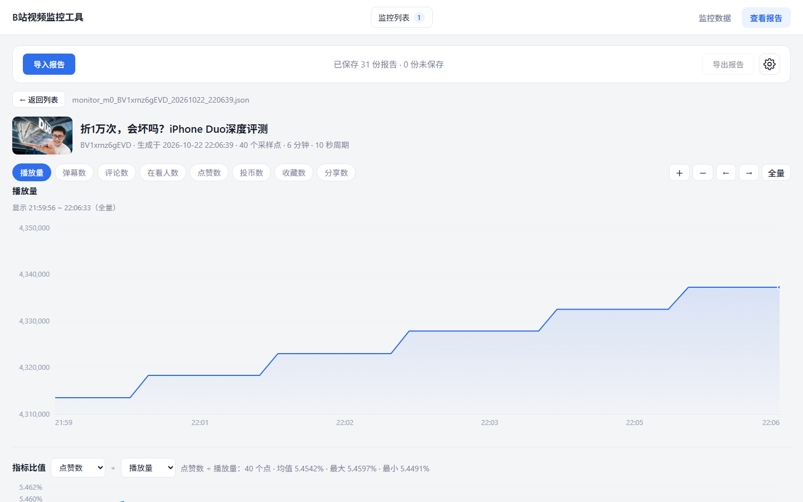

# B站视频监控工具

按固定周期采样 B 站视频的公开数据，把零散的数字连成一条可回看的曲线，停止时归档为 JSON 报告。



## 它解决什么问题

B 站视频页只显示当前数字，看不到这一小时涨了多少、哪个指标先动。

这个工具按周期记录播放量、弹幕、点赞等 8 项指标，画出趋势曲线并支持任意两项做比值，
  
用来判断内容是否在起量、增长来自哪一项、爆发点出现在什么时候。

典型用法：观察自己投稿的早期数据、跟踪同题材视频的传播节奏、回看某个视频的爆发过程。

## 功能

- **多监控**：同时跟踪最多 5 个视频，各自独立采样，切换只切换查看，采集在后台继续
- **8 项指标**：播放量、弹幕、评论、同时在看、点赞、投币、收藏、分享
- **实时趋势**：指标卡片 + 主图，时间窗口 5 分钟 / 30 分钟 / 2 小时 / 12 小时 / 全部
- **采样周期可热改**：5–3600 秒，改完立即按新节奏排下一次，不影响已采数据
- **整点采样**：可选把首次采样对齐整点，便于多视频横向对比
- **报告**：停止即生成 JSON，支持下载、导入、导出、删除，内容相同的自动去重
- **报告详情**：多指标叠加、滚轮缩放、拖动平移、悬停读数、任意两项指标比值
- **零依赖**：后端只用 Python 标准库，前端自绘 Canvas，无构建步骤、无 CDN

## 快速开始

### 环境

| 项目     | 要求                                                   |
| ------ | ---------------------------------------------------- |
| Python | 3.12 或以上                                             |
| 系统     | Windows（`start.bat` 依赖 CMD）；其他平台用 `python app.py` 启动 |
| 网络     | 能访问 `api.bilibili.com`                               |
| 账号     | 不需要登录，只读取公开数据                                        |

### 快速启动

Windows 双击 `start.bat`，或命令行执行：

```bash
python app.py
```

浏览器会自动打开 `http://127.0.0.1:8765/`。可用参数：

| 参数             | 默认     | 说明                     |
| -------------- | ------ | ---------------------- |
| `--port`       | `8765` | 端口被占用时自动向后顺延，最多尝试 20 个 |
| `--no-browser` | 关      | 不自动打开浏览器               |

## 使用

### 1. 开始监控

在「监控数据」页输入视频链接、BV 号、av 号或 `b23.tv` 短链，设定采样周期（默认 30 秒），点「开始监控」。

第一个采样点默认立即产生，之后按周期继续；开启「整点采样」时首个采样点改为对齐时刻。顶部「监控列表」可新建多个监控，彼此独立，采集都在后台进行。

### 2. 观察数据

主图按所选时间窗口绘制趋势，右侧显示当前指标值与增量。采样周期随时可改，顶部的「整点采样」会把首次采样对齐到整点：

| 采样周期   | 对齐粒度  |
| ------ | ----- |
| ≥ 5 分钟 | 半小时整点 |
| < 5 分钟 | 整分钟   |

### 3. 停止与报告

点「停止」结束采样并生成报告。直接关闭服务窗口时，**所有**运行中的监控都会各自结算一份报告，不会丢数据。

### 4. 管理报告

「查看报告」页集中管理所有报告：

| 操作 | 说明                           |
| -- | ---------------------------- |
| 导入 | 选文件或目录（目录不递归），复制进 `reports/` |
| 导出 | 选目录直接写入磁盘，或交给浏览器逐个下载         |
| 删除 | 从 `reports/` 移除              |
| 查看 | 进入详情：多指标叠加、缩放平移、悬停读数、比值分析    |

内容相同的报告只保留一份；已经落盘进 `reports/` 的报告，不会在列表中重复显示为「未保存」。

## 指标

| 键          | 名称   | 说明                |
| ---------- | ---- | ----------------- |
| `view`     | 播放量  |                   |
| `danmaku`  | 弹幕数  |                   |
| `reply`    | 评论数  |                   |
| `online`   | 同时在看 | 部分视频不开放该数据，取不到时为空 |
| `like`     | 点赞数  |                   |
| `coin`     | 投币数  |                   |
| `favorite` | 收藏数  |                   |
| `share`    | 分享数  |                   |

所有数值均为采集时刻 B 站接口返回的原值，工具不做换算或估算。

## 报告格式

```json
{
  "schema_version": "1.0",
  "report_type": "bilibili_video_monitor",
  "generated_at": "2026-10-22T22:06:39+08:00",
  "video": {
    "bvid": "BV1xrnz6gEVD", "aid": 113000000000000,
    "title": "…", "owner": "…", "cover": "…",
    "duration": 480, "pubdate": 1729000000, "cid": 260000000, "url": "…"
  },
  "monitor": {
    "id": "m0",
    "started_at": "2026-10-22T21:59:56+08:00",
    "stopped_at": "2026-10-22T22:06:39+08:00",
    "duration_seconds": 402.6,
    "interval_seconds": 10,
    "sample_count": 40,
    "success_count": 40,
    "failure_count": 0,
    "last_error": null
  },
  "metrics": {
    "view": {
      "label": "播放量",
      "first": 4313586, "last": 4337311, "delta": 23725,
      "min": 4313586, "max": 4337311, "average": 4325826.05,
      "peak_gain": 4862, "peak_gain_at": "2026-10-22T22:03:10+08:00",
      "average_per_minute": 3584.225, "sample_count": 40
    }
  },
  "samples": [
    { "time": "2026-10-22T21:59:56+08:00", "elapsed_seconds": 0.0,
      "view": 4313586, "danmaku": 55648, "reply": 31043, "online": null,
      "like": 235388, "coin": 123391, "favorite": 47351, "share": 28822 }
  ]
}
```

`average_per_minute` 为整段监控的分钟均值；`peak_gain` 是相邻两次采样的最大增量及其发生时间。

## 项目结构

```
app.py                启动入口，只做装配，不含业务逻辑
bilimon/
  collector.py        接口请求、限流冷却、指标解析
  session.py          单次监控的状态机与采样线程
  schedule.py         整点对齐的时刻计算
  report.py           会话 → 报告结构
  reports.py          报告仓库的读写、导入导出、去重
  control.py          多监控编排
  settings.py         配置读写
  server.py           HTTP 服务与静态资源
  filepicker.py       目录浏览（只读）
web/
  index.html  style.css
  app.js              监控页：轮询、渲染、交互
  report-page.js      报告页：列表、详情图表、导出
  chart.js            自绘折线图
  filepicker.js       统一的文件/目录选择器
tests/                后端测试
web/tests/            图表测试
docs/                 架构说明与图表
```

## 测试

```bash
test.bat
```

- 后端：Python 标准库 `unittest`，233 项，覆盖采集、会话、报告、配置、HTTP 与安全边界
- 前端：Node 内置 `node:test`，18 项，覆盖刻度计算、数值格式化、坐标映射

未安装 Node 时只跑后端。也可以分开执行：

```bash
python -m unittest discover -s tests -t .
node --test "web/tests/*.test.js"
```

## 运行期文件

| 路径              | 内容                     | 是否入库 |
| --------------- | ---------------------- | ---- |
| `reports/`      | 报告仓库，首次写入时自动创建         | 否    |
| `config.json`   | 本机设置（自动保存目录、导入目录、整点采样） | 否    |
| `cooldown.json` | 限流冷却状态，重启后继续生效         | 否    |

## 常见问题

**端口被占用？**
  
自动向后顺延最多 20 个端口，实际地址以启动窗口打印的为准。

**页面提示「与本地服务断开」？**
  
服务进程已退出，重新运行 `start.bat`。

**接口返回 403？**
  
只接受来自本机页面的请求：`Host` 必须是 `127.0.0.1` / `localhost` / `::1`，`Origin` 存在时必须同端口同源。

**提示「B站 正在限制访问」？**
  
触发了 B 站风控（HTTP 412），工具会暂停请求 90 秒并给出倒计时。调大采样周期可降低触发概率。

**局域网内其他设备打不开？**
  
服务只监听回环地址，不对外暴露，设计如此。

**重启后监控和报告都没了？**
  
监控与样本只存在内存中，重启即丢失；报告在停止时才落盘，已落盘的不会丢。

## 已知边界

- 同一视频可以存在于多个槽位并各自采样，请求量与限流风险随之叠加
- 限流冷却全局生效，一个视频触发风控会让所有监控一起暂停
- 采样时刻受线程调度与系统时钟影响，实测与计划时刻偏差 1–2 毫秒
- 报告时间戳固定为 `+08:00`，跨时区查看时与浏览器本地时间存在偏移
- 只实现 GET 与 POST，`HEAD` 返回 501
