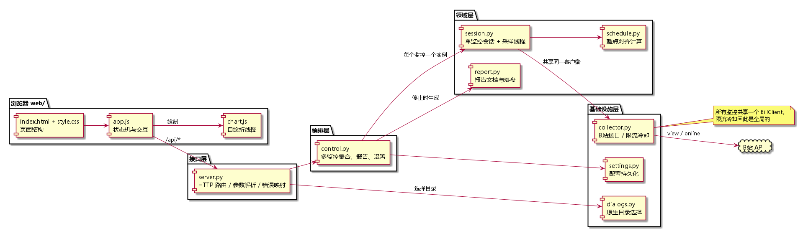
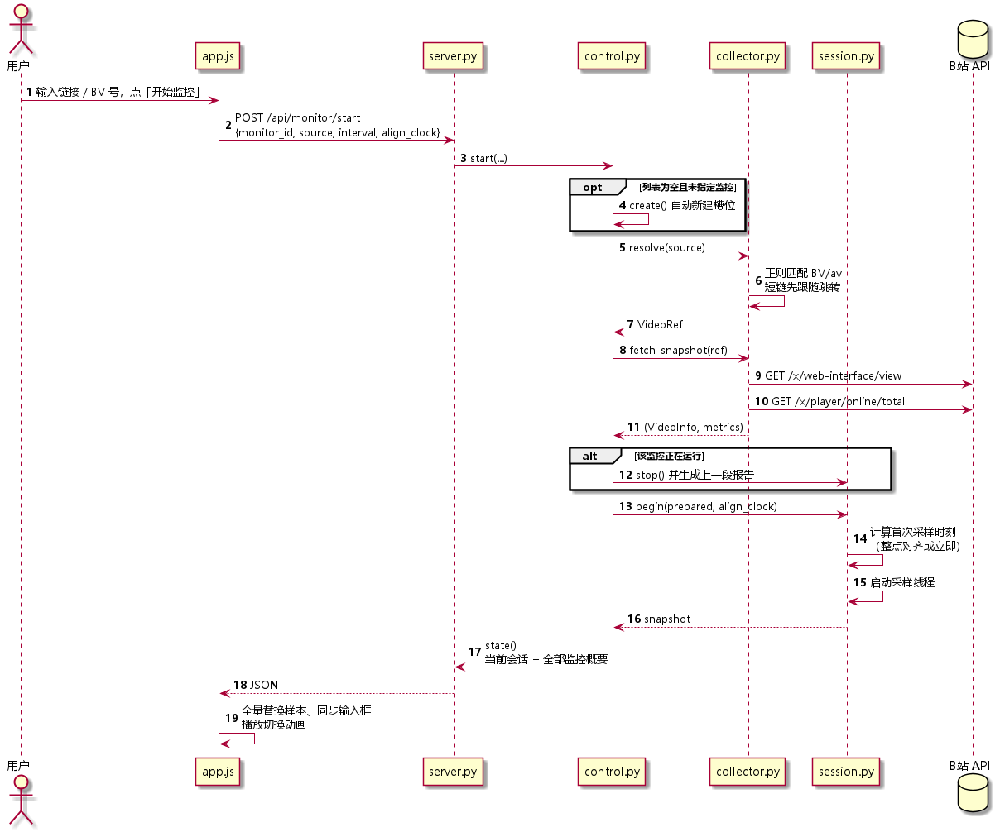
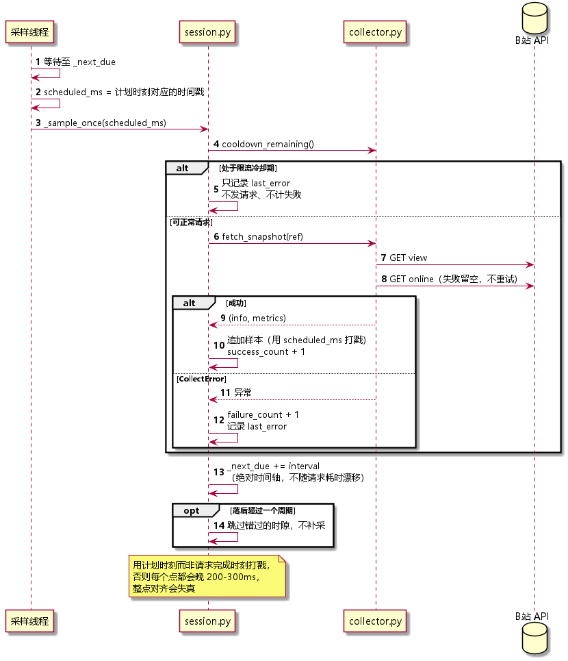
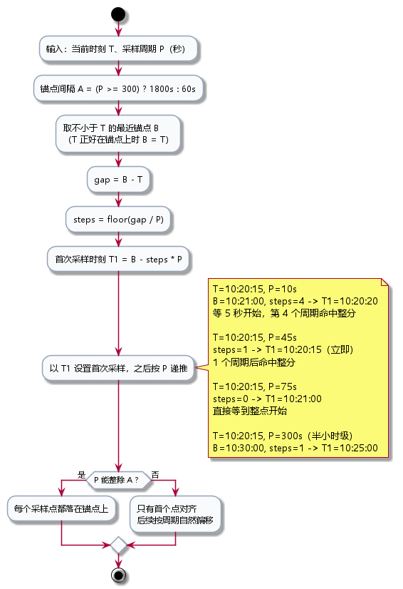
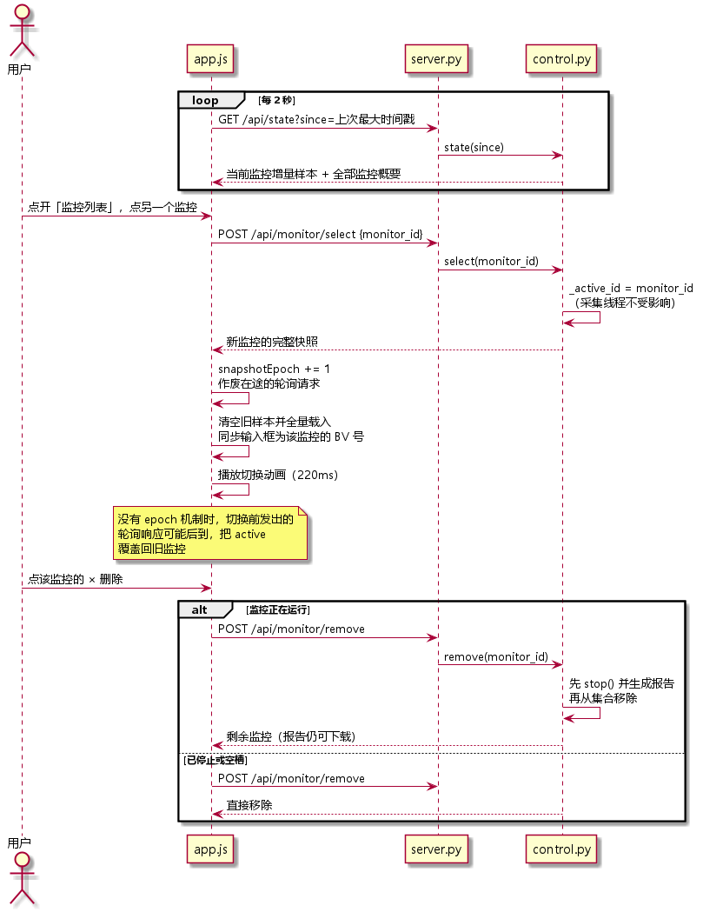
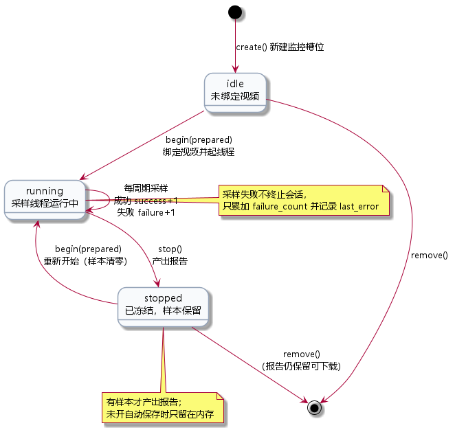
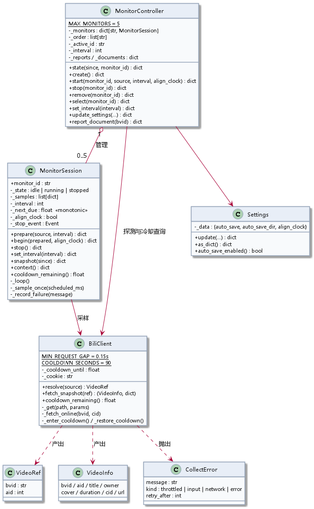

# 监控模块架构与流程

本文描述 B站视频监控工具的模块划分、核心概念与全部关键流程。图示见 `docs/diagrams/`。

## 1. 分层与职责

| 层 | 模块 | 职责 | 明确不做的事 |
|---|---|---|---|
| 入口 | `app.py` | 装配各层、端口顺延、拉起浏览器 | 不含业务逻辑 |
| 接口 | `server.py` | HTTP 路由、参数解析、异常到状态码的映射 | 不持有状态 |
| 编排 | `control.py` | 监控集合、当前查看项、报告产出、设置读写 | 不碰网络与线程 |
| 领域 | `session.py` | 单个监控的状态机、采样线程、样本容器 | 不做 HTTP |
| 领域 | `schedule.py` | 整点对齐的纯计算 | 无任何副作用 |
| 领域 | `report.py` | 报告的构造、命名、落盘 | 不关心谁触发 |
| 领域 | `reports.py` | 报告仓库：扫描 `reports/`、校验、导入重命名、导出、删除 | 不涉及 HTTP 与会话 |
| 基础 | `collector.py` | 解析输入、请求 B站、限流冷却 | 不决定采样节奏 |
| 基础 | `settings.py` | 三项配置的持久化 | — |
| 基础 | `filepicker.py` | 目录列举，供统一的文件/目录选择器使用 | 只读，不判断内容 |

设计原则：任意一层只依赖下一层，`schedule.py` 与 `report.py` 都是纯函数模块，可以脱离网络与线程单独验证。

## 2. 核心概念

| 概念 | 含义 | 关键约束 |
|---|---|---|
| 监控（槽位） | 一个独立的监控条目，由 `monitor_id`（`m1`、`m2`…）标识 | 最多 5 个；可以只创建不配置 |
| 会话 | 槽位的运行时载体 `MonitorSession`，持有样本与线程 | 一个槽位对应一个会话，二者生命周期一致 |
| 样本 | 一次采样得到的 8 项指标快照 | `{t, view, danmaku, reply, online, like, coin, favorite, share}`，上限 20000 条 |
| 报告 | 停止时由样本生成的 JSON 文档 | 有样本才生成；键为 `monitor_id` |
| 当前监控 | 界面正在查看的槽位 `_active_id` | 只影响展示，不影响采集 |

## 3. 接口清单

| 方法 | 路径 | 说明 |
|---|---|---|
| GET | `/api/state?since=&monitor_id=` | 当前监控快照（顶层平铺）+ 全部监控概要 + 设置 + 冷却剩余 |
| GET | `/api/report?monitor_id=` | 下载报告 JSON，已移除监控的报告仍可取 |
| POST | `/api/monitor/create` | 新建空白槽位并切换过去 |
| POST | `/api/monitor/start` | 绑定链接并开始采集（同一监控再次调用＝重启） |
| POST | `/api/monitor/stop` | 停止指定（或当前）监控并产出报告 |
| POST | `/api/monitor/remove` | 移除槽位；运行中先停止并保留报告 |
| POST | `/api/monitor/select` | 切换当前查看的监控 |
| POST | `/api/monitor/interval` | 修改当前监控的采样周期 |
| POST | `/api/settings` | 更新自动保存、目录、整点采样 |
| GET | `/api/fs?path=&mode=&ext=` | 目录列举，供统一的文件/目录选择器使用 |
| GET | `/api/reports` | 报告页数据：已保存列表 + 会话内列表 + 报告目录 + 自动导入目录 |
| GET | `/api/reports/detail?key=` | 报告详情；`key` 为仓库文件名或 `live:m1` |
| POST | `/api/reports/import` | 弹系统对话框选文件或目录后导入，并复制到 `reports/` |
| POST | `/api/reports/export` | 按文件名或监控 id 批量导出到目标目录 |
| POST | `/api/reports/delete` | 删除仓库内的一份报告 |
| POST | `/api/reports/save-live` | 把会话内尚未落盘的报告写入仓库目录 |

所有 `/api/*` 只接受本机来源：`Host` 必须是 `127.0.0.1` / `localhost` / `::1`，`Origin` 存在时必须同端口同源，否则返回 403。请求体上限 1 MB。

错误到状态码：`throttled → 429`（附 `retry_after`）、`network → 502`、输入/业务错误 `→ 400`、其余 `→ 500`。

## 4. 关键流程

### 4.1 开始监控

`prepare_snapshot()` 先完成"解析链接 + 探测一次快照"，这一步在改变会话状态**之前**执行，因此链接无效时槽位保持原样。探测得到的快照只在立即开始时计入样本；开启整点采样且首个采样点需要等待时，它只用于校验，不计入。

同一监控处于运行中时再次开始，会先 `stop()` 结算上一段报告，再以新参数重新开始。

### 4.2 采样循环

三条关键规则：

1. **绝对时间轴**：`_next_due += interval`，而不是"采样完成后重新计时"。否则每轮 0.3–1 秒的请求耗时会累加进周期，十几轮后偏离整点若干秒。
2. **计划时刻打戳**：样本时间取计划时刻而非请求完成时刻，否则每个点固定晚 200–300 毫秒。
3. **冷却期静默**：`BiliClient` 处于冷却时直接跳过本轮，不发请求也不计失败，只更新提示文案。

单次采样固定两个请求：`view`（全部计数）与 `online`（同时在看）。`online` 请求失败只留空值，不影响其余 7 项。

### 4.3 整点对齐

周期 ≥300 秒对齐半小时（`HH:00:00`、`HH:30:00`），否则对齐整分钟。锚点按**本地时区**计算，跨时区正确。

能整除锚点间隔的周期（5/6/10/12/15/20/30/60/300/450/600/900/1800 秒）会持续命中整点；不能整除的（如 45、75 秒）只有首个点对齐，后续按周期自然偏移。

### 4.4 停止与报告

`stop()` 冻结会话（保留样本），随后 `report.build()` 生成文档。是否落盘由 `auto_save` + `auto_save_dir` 决定，落盘失败只记录 `save_error`，不影响报告在内存中可用。

报告同时在两个位置留存：`_reports[monitor_id]`（摘要，用于面板展示）与 `_documents[monitor_id]`（完整文档，用于下载）。二者以 `monitor_id` 为键，因此监控被移除后仍可下载，超出归档窗口的条目会被释放。

服务退出时走 `stop_all()`，逐个结算所有运行中的监控，与当前选中项无关。

### 4.5 多监控切换

前端每 2 秒轮询一次，携带 `since=已有最大时间戳` 做增量拉取。切换动作是 `POST select`，服务端只改 `_active_id`，采集线程不受影响。

两个易错点：

- **增量跨会话失效**：切换后 `since` 无意义，前端检测到 `active_monitor` 变化会强制全量拉取。
- **轮询竞态**：切换前发出的轮询响应可能后到并覆盖新状态。用 `snapshotEpoch` 版本号在响应回来时比对，过期响应直接丢弃。

### 4.6 会话状态机

`idle → running → stopped`，`stopped` 可再次 `running`（样本清零）。采样失败不会离开 `running`，只累加失败计数。

### 4.7 类关系

## 5. 限流与配额

| 项 | 值 | 说明 |
|---|---|---|
| 单次采样请求数 | 2 | `view` + `online` |
| 相邻请求最小间隔 | 0.15 秒 | 避免两个接口背靠背 |
| 触发冷却的返回码 | -352 / -412 / -509 / -799 | 命中即进入冷却 |
| 冷却时长 | 90 秒 | 期间不发任何请求 |
| 冷却作用域 | 全局 | 所有监控共享同一客户端 |
| 冷却持久化 | `cooldown.json` | 重启后继续生效，避免立刻再撞 |

同时监控 5 个、周期 10 秒时约每分钟 60 个请求，极易触发限流；周期设为 30 秒以上时约每分钟 20 个，风险可控。

## 6. 前端结构

| 模块 | 职责 |
|---|---|
| `app.js` | 页面状态、轮询、渲染、交互（按"数据 → 渲染 → 交互"分区） |
| `chart.js` | 自绘折线图：DPR 缩放、Y 轴按最长标签动态留白、单点居中刻度、悬停提示 |
| `report-page.js` | 报告列表、详情图表、导出与筛选 |
| `filepicker.js` | 统一的文件/目录选择器，所有选择入口共用 |
| `style.css` | 两列栅格、三档响应式（>1080 / 720–1080 / <720）、悬浮面板 |

页面状态 `state` 的关键字段：`samples`、`lastT`（增量游标）、`monitors`、`activeMonitor`、`report`。轮询竞态由闭包内的 `snapshotEpoch` 版本号拦截，它不放在 `state` 里。

## 7. 已知边界

| 边界 | 现状 |
|---|---|
| 数据持久化 | 监控与样本仅存内存，重启服务后丢失；设置写在 `config.json` |
| 报告留存 | 存在内存，重启后不可下载 |
| 采样精度 | 受 Python 线程调度与系统时钟影响，实测与计划时刻偏差 1–2 毫秒 |
| 单视频多会话 | 服务端不查重，同一视频可存在于多个槽位并各自独立采样，请求量与限流风险随之叠加 |
| 冷却粒度 | 全局生效，一个视频触发限流会让所有监控一起暂停 |
| 请求来源 | 仅接受本机页面；`Host` 或 `Origin` 不匹配返回 403 |
| HTTP 方法 | 只实现 GET 与 POST，`HEAD` 返回 501 |

## 8. 文件与目录选择

全项目只有一套选择器，避免到处弹系统对话框：

| 组成 | 说明 |
|---|---|
| `bilimon/filepicker.py` | `list_directory(path, mode, exts)`，只读列目录 |
| `GET /api/fs` | 参数 `path`、`mode`（any/dirs/files）、`ext`（逗号分隔的扩展名） |
| `web/filepicker.js` | `FilePicker.open({mode, exts, title, initialPath, multi})` 返回所选路径数组 |

`mode` 决定可勾选的目标：`dirs` 只列目录并可勾选当前目录，`files` 只允许勾选文件（目录仍可进入导航），`any` 两者皆可，因此支持**同一对话框内混合多选文件与目录**。`exts` 为空表示不限扩展名。

调用方：报告导入（`any` + `json`）、报告导出目录（`dirs` + 单选）、监控页的自动保存目录（`dirs` + 单选）。

## 9. 报告页

### 9.1 结构

顶部一条横条（菜单栏之下、通栏）：左侧「导入报告」，中间「已保存 n 份报告 · m 份未保存」，右侧「导出报告」与齿轮。横条下方是报告表格，点击某行才进入详情视图。

### 9.2 列表

| 能力 | 说明 |
|---|---|
| 排序 | 会话内未保存的报告始终置顶，同组内按所选维度排序 |
| 筛选 | 来源（全部/未保存/已保存）+ 标题或 BV 号关键词 |
| 选择 | 行首复选框，表头支持当前页全选（含半选态） |
| 删除 | 仅已保存的报告可删，二次确认 |
| 分页 | 每页 10 / 20 / 50 可选，显示总份数与页码 |

### 9.3 导出

| 情形 | 行为 |
|---|---|
| 已设置导出目录 | 服务端复制文件，提示「已导出至 <目录>」 |
| 未设置 | 由浏览器逐个下载（间隔 300ms 触发），提示「已开始下载 n 份报告」 |
| 齿轮 → 选择导出目录 | 记住到 `localStorage`，之后所有导出都去该目录 |
| 齿轮 → 全部导出 | 预填上次目录（没有则先选），二次确认后导出全部 |

监控页的报告下载同样走浏览器下载，并给出「已开始下载」提示。

### 9.4 重复报告的去重

报告用「内容签名」判重：`(bvid, generated_at)`。同一视频在同一时刻只可能产生一份报告，因此签名相同即视为同一份。

| 情形 | 处理 |
|---|---|
| 自动保存后 | 已落盘的那份不再计入「未保存」，列表里只出现一次（来源显示「已保存」） |
| 导入的文件已在 `reports/` 内 | 跳过，提示「已在 reports 目录中」 |
| 导入的文件内容与仓库某份相同 | 跳过，提示「仓库中已有相同报告」 |
| 导出目录选了 `reports/` 本身 | 拒绝，提示仓库内的报告无需再导出 |
| 导出到其它目录且已有同名文件 | 保留仓库原名，重名追加 `-2` |

**手动放进 `reports/` 的文件不会被改名**，按原文件名列出、按原名下载。需要统一命名时，用「导入报告」把它从仓库外导入一次即可（此时会按 `monitor_{id}_{bvid}_{time}.json` 重命名）。但如果内容与仓库已有报告相同，会被跳过而不是改名。

### 9.5 自动导入目录

报告默认自动保存到**仓库目录**（`reports/`），因此监控一停止，报告立刻出现在「查看报告」里，无需任何手动操作。

「查看报告 → 齿轮 → 报告自动导入目录」可管理额外的来源目录：

| 类型 | 来源 | 可否移除 |
|---|---|---|
| 仓库 | `reports/` 固定包含 | 不可 |
| 自动保存 | 「监控数据」里设置的自动保存目录，自动带上 | 不可 |
| 自定义 | 用户手动添加 | 可 |

打开报告页时，会扫描这些目录，把仓库中尚未收录的报告复制进仓库（按 `monitor_{id}_{bvid}_{time}.json` 重命名）。已收录过的按内容签名跳过，不会重复。

### 9.6 详情

点行后列表隐藏、详情视图展开，左上角「返回列表」。内容包含视频信息、8 个指标页签的主图、视窗控制（滚轮缩放 / 拖动平移 / 按钮 / 双击复位）、指标比值小图，末尾保留 45vh 空白，比值图之后仍可继续向下滚动。详见 10 节。

## 10. 图表与数据分析

### 10.1 三种展示形式

| 形式 | 进入方式 | 纵轴 | 说明 |
|---|---|---|---|
| 单指标趋势 | 默认，点选一个指标 | 该指标的真实刻度 | 折线 + 面积填充 |
| 多指标叠加 | 再点选 1–2 个指标（最多 3 条） | 不显示 | 每条线按自己的量程撑满绘图区，只比较形状 |
| 聚焦某条线 | 点图例中的指标名 | 切换为该指标的刻度 | 该线加粗、其余变淡；再点一次取消聚焦 |
| 指标比值 | 详情页下方选择 A、B | 百分比 | 逐点计算 A ÷ B，选择即更新 |

图例只在叠加两条以上时出现。

悬停：把光标移到折线上，显示该点的时间与数值。单指标始终可用；多指标叠加时需先点图例聚焦某条线，读数取该线在该时刻的值，提示点颜色跟随该指标。未聚焦时不显示读数。

### 10.2 视窗能力

| 操作 | 行为 |
|---|---|
| 滚轮上滚 | 以光标所在时间为锚点放大，160ms 缓动 |
| 滚轮下滚 | 已放大时缩小；已处于全量时交给页面滚动 |
| Ctrl / ⌘ + 滚轮 | 始终缩放 |
| 按住拖动 | 平移窗口，直接跟手不做缓动 |
| ＋ / － | 以绘图区中心缩放（0.7× / 1.4×），缓动 |
| ← / → | 按窗口宽度 25% 步进平移，缓动 |
| 双击 / 「全量」 | 复位到完整范围，缓动并清空视窗 |

Y 轴按全量数据计算，并在数据范围上下各留 15% 空白；数据从 0 起算时不往下留白。缩放与平移时纵轴固定不动。重绘通过 `requestAnimationFrame` 合并到下一帧。

### 10.3 刻度

刻度的小数位由**步长**决定，与数值大小无关：步长 0.005 取 3 位、2.5 取 1 位、20 取 0 位。利率、比值这类数值落在 18.7 附近但跨度只有 0.02 的指标，既能显示 18.735 / 18.740，也不会出现所有刻度都是 19 的情况。

刻度值的有效位按步长保留，只抹掉浮点累加误差；统一舍入到固定小数位会把相邻刻度压成同一个值。

`fitScale` 在取整后数据占不到 55% 高度时，改用更密的刻度重算，避免曲线被取整后的范围压扁。

### 10.4 比值分析

选择两个指标 A、B，逐点计算 `A / B`，跳过缺失或分母为 0 的点，输出点数、均值、最大值、最小值。曲线以百分比绘制，纵轴刻度带 `%`，统计值按 5 位有效数字输出并去掉末尾 0。
